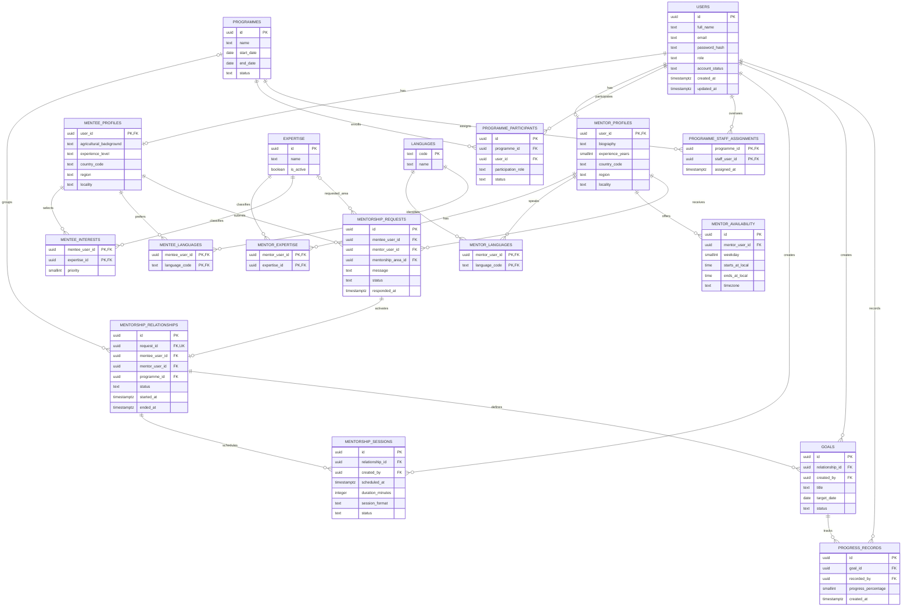

# Phase 2 — Database architecture and design review

**Status: design baseline approved on 2026-11-02; implementation status updated
2026-11-06.** This document preserves the dated checkpoints below. For current
production migration status, see the final addendum; it supersedes earlier
statements that the mentorship migrations were unapplied.

## Sprint 2 implementation completion — local code only

The backend implementation now includes a standalone migration runner, PostgreSQL
Programme Staff profile support, expanded in-memory tests, and an opt-in
PostgreSQL integration test suite. These changes do not authorize database writes. At that implementation
checkpoint no connection, SQL execution, migration, or Neon project/branch
change had occurred. A later health-check attempt may have initiated a
read-only connection; see the final addendum. Express startup remains separate
from migration execution.

### Migration runner

`server/src/migration-runner.js` discovers numerically prefixed SQL files,
computes SHA-256 checksums, rejects malformed/duplicate versions and SQL
transaction-control statements, and offers a no-connection dry-run. Apply
mode uses a dedicated client and a separate transaction for each migration,
sets lock/statement timeouts, takes a transaction-scoped PostgreSQL advisory
lock, bootstraps and validates the ledger columns and primary key, verifies
stored name/checksum metadata, skips exact matches, rejects checksum drift and
out-of-order application, executes the SQL body, records version/name/checksum/
timestamp/actor, and commits. Errors trigger rollback; rollback errors are
surfaced with the original error. `server/scripts/migrate.js` requires
`--apply` and `MIGRATION_DATABASE_URL`; it never falls back to `DATABASE_URL`.
Default/`--dry-run` mode does not construct a database pool. `server/src/index.js`
does not import or call the runner. Both runtime and migration pools use the
shared URL validator, which rejects remote URLs without TLS and validates
remote certificates.

Each migration is atomic, but the entire set of multiple migrations is not a
single transaction: if a later migration fails, an earlier committed migration
remains recorded and is safely skipped on a matching retry. No apply mode or
database connection was invoked for this task.

### Programme Staff and role consistency

The PostgreSQL repository now inserts the `programme_staff_profiles` row in
the same account/session transaction as the user, retrieves the staff
organization/job title, and updates those fields transactionally with
160-character validation. Profile retrieval requires an expected role and
returns no profile if the account role or required role-profile row does not
match. Updates first lock and verify an active account with the authenticated
role. Staff profiles expose `createdAt` from `users.created_at`: account and
required profile are created in the same PostgreSQL transaction, where
`now()` is transaction-stable; the existing proposal has no separate
profile-level `created_at` column. The account's `updated_at` and staff
profile's `updated_at` remain distinct.

Auth validation rejects role fields, validates staff organization/job title,
and does not accept a role choice during login. Password hashing, opaque
hashed session tokens, expiry, logout revocation, and server-side field/role
checks remain in place. UI tab hiding is not authorization. The current schema
triggers and foreign keys still require PostgreSQL integration validation.

### Test preparation and boundaries

The default test suite covers all three roles on the in-memory repository,
case-insensitive duplicate email, incorrect passwords, saved-role retrieval,
attempted role changes, missing/mismatched profiles, staff profile
create/read/update, session expiry/revocation, and mocked migration-runner
checksum, duplicate, locking, rollback, and dry-run behavior.

`server/test/postgres-auth.integration.test.js` is gated by
`AGRI_MENTOR_ENABLE_DISPOSABLE_DB_TESTS=1` and
`AGRI_MENTOR_POSTGRES_TEST_DATABASE_URL`. It refuses databases not named
`agri_mentor_test`; remote Neon targets must use a `.neon.tech` host and
`sslmode=require`. It exercises the real repository and API and creates
synthetic accounts, so it is designed only for a newly created disposable
database with the reviewed migration already applied. It is not run by the
default suite and must not be enabled until that isolated target and test run
are separately authorized. No PostgreSQL integration test was run here.

No change to `server/migrations/001_auth_profiles.sql` is required by the
implementation: the staff profile creation time is represented by the account
creation timestamp because registration inserts both rows atomically. No
broader programme permissions, Cloudinary work, NativeWind installation,
dependency change, Sprint 3 feature, deployment, commit, or push was done.

## Sprint 2 final review and preparation — 2026-11-03

This section records the current auth/profile implementation and a proposal
for later Neon and Cloudinary work. It is preparation only: no Neon
credentials were requested or used, no database was connected to, no SQL was
executed, no branch was created, and no database or Cloudinary state was
changed.

### Authentication review

The current code implements the required registration/login shape:

- Registration UI offers Mentee, Mentor, and Programme Staff. The API maps
  the mobile `staff` value to `programme_staff`; the backend validates and
  inserts that role into `users.role`.
- Login submits only email and password. The PostgreSQL repository reads the
  stored role from `users`; the response includes it, and mobile maps it back
  to the local role model.
- Registration and login both set the returned account in app state and route
  through `/`, which redirects signed-in users to the role-specific dashboard
  content. Login has no role selector.
- Profile routes require a bearer session. The backend validates updates
  against the authenticated user's role; Programme Staff can only change
  common name/phone fields. Tabs are also hidden by role, but tab visibility
  is only a UI affordance, not authorization.
- Native tokens use SecureStore. The web preview keeps its token in memory,
  so a browser reload requires another sign-in.

Limits and inconsistencies to resolve before claiming production-ready
authorization:

- The role and profile routes have only been exercised with an in-memory
  repository. Login role recovery and role dashboards have not been tested
  against PostgreSQL.
- The revised migration candidate makes roles immutable with a database
  trigger, uses fixed role discriminators and composite foreign keys to reject
  mismatched profile rows, and uses deferred constraint triggers to require
  exactly the profile appropriate to the account role at transaction commit.
  These constraints have not been run against PostgreSQL and still require
  integration validation.
- The PostgreSQL repository now creates all three role-matched profiles
  transactionally and retrieves staff organization/job title. Profile reads
  require the stored account role; an absent or mismatched role profile is not
  returned. This repository path has not yet been run against PostgreSQL.
- API profile validation does not accept a `role` field and the repository
  does not update `users.role`. The database trigger adds a second guard.
  Superusers/owners can alter schema/triggers, so operational privileges must
  be restricted and role changes must not be offered as a regular account
  operation.
- Backend profile-field restrictions are implemented, but no backend request,
  matching, programme, participant, goal, or session APIs exist yet. Do not
  imply that role-based access to those features is implemented; each future
  endpoint needs server-side identity, role, ownership, and (for staff)
  programme-assignment checks.
- Local tests cover registration/login for all three roles, profile-field and
  immutable-role API behavior, session handling, and mocked migration-runner
  behavior. The opt-in PostgreSQL suite is prepared but not run. No automated
  device test proves role-to-dashboard navigation against a central database.

### Exact proposed first-migration schema

`server/migrations/001_auth_profiles.sql` currently proposes nine tables,
including the migration ledger.
This is a description of the checked-in proposal, not authorization to apply
it. The SQL file is a migration body and must be run only by a reviewed,
transactional migration runner.

| Table | Columns and relationships | Constraints and indexes |
|---|---|---|
| `schema_migrations` | `version TEXT`; `name TEXT`; SHA-256 checksum; `applied_at`; `applied_by`. Runner metadata, not user data. | PK `version`; runner creates/validates this ledger under a transaction-scoped advisory lock. The runner records the checksum only after successful DDL and rejects a different checksum for an already-applied version. |
| `users` | `id UUID`; `full_name TEXT NOT NULL`; `email TEXT NOT NULL`; `password_hash TEXT NOT NULL`; `role TEXT NOT NULL`; `account_status TEXT NOT NULL DEFAULT 'active'`; `phone TEXT NOT NULL DEFAULT ''`; `created_at TIMESTAMPTZ NOT NULL DEFAULT now()`; `updated_at TIMESTAMPTZ NOT NULL DEFAULT now()`. Root identity for profiles and sessions. | PK `id`; unique `(id, role)` supports role-bound profile FKs; case-insensitive unique index on `lower(email)`; full-name length 2–120, email length 3–254, phone length ≤40; role check for `mentee`, `mentor`, `programme_staff`; status check for `pending`, `active`, `suspended`, `closed`; role/status index; before-update trigger prevents changing role; before-delete trigger requires account closure/anonymization instead of physical deletion. |
| `mentee_profiles` | `user_id UUID`; fixed `account_role = 'mentee'`; `location`; `biography`; `agricultural_background`; `experience_level`; `needs`; `updated_at`. | PK `user_id`; role discriminator check; composite FK `(user_id, account_role)` to `users(id, role) ON DELETE/UPDATE RESTRICT`. |
| `mentor_profiles` | `user_id UUID`; fixed `account_role = 'mentor'`; `location`; `biography`; nullable `experience_years SMALLINT`; `specialisation`; `qualifications_summary`; `updated_at`. | PK `user_id`; role discriminator check; composite FK to `(users.id, users.role)`; years null or 0–100. |
| `programme_staff_profiles` | `user_id UUID`; fixed `account_role = 'programme_staff'`; `organization`; `job_title`; `updated_at`. API `createdAt` is sourced from `users.created_at` because required user/profile rows are created in the same transaction. | PK `user_id`; role discriminator check; composite FK to `(users.id, users.role)`. Registration must create this row; it does not grant programme access. |
| `expertise` | `id UUID`; `name TEXT NOT NULL`; `is_active BOOLEAN NOT NULL DEFAULT TRUE`; `created_at TIMESTAMPTZ NOT NULL DEFAULT now()`. | PK `id`; name length 1–80; case-insensitive unique index on `lower(name)`. |
| `mentor_expertise` | `mentor_user_id UUID NOT NULL`; `expertise_id UUID NOT NULL`. | Composite PK; FKs to `mentor_profiles(user_id)` and `expertise(id)`, both RESTRICT; reverse lookup index on `(expertise_id, mentor_user_id)`. |
| `mentee_interests` | `mentee_user_id UUID NOT NULL`; `expertise_id UUID NOT NULL`. | Composite PK; FKs to `mentee_profiles(user_id)` and `expertise(id)`, both RESTRICT; reverse lookup index on `(expertise_id, mentee_user_id)`. |
| `auth_sessions` | `id UUID`; `user_id UUID NOT NULL`; `token_hash CHAR(64) NOT NULL`; `expires_at TIMESTAMPTZ NOT NULL`; nullable `revoked_at TIMESTAMPTZ`; `created_at TIMESTAMPTZ NOT NULL DEFAULT now()`. | PK `id`; unique token digest; FK to `users(id) ON DELETE RESTRICT`; expiry-after-creation check; index on `(user_id, expires_at)`. |

The SQL adds three types of role integrity protection: (1) fixed profile-role
values plus composite foreign keys prevent a mentee/mentor/staff profile from
belonging to a user with a different role; (2) a `BEFORE UPDATE OF role`
trigger forbids registered-account role changes; and (3) deferred constraint
triggers on `users` and all three profile tables require the matching profile
to exist at commit. This permits account and profile inserts in one
transaction while rejecting a missing profile or profile deletion at commit.
The backend must create user, matching role profile, and initial auth session
atomically. Role-specific profile consistency does not authorize access to
other users' data.

The migration has no destructive user-data statements, but the non-ledger
DDL is intentionally not idempotent. `CREATE TABLE IF NOT EXISTS` is used
only for the ledger bootstrap; the runner must check its version/checksum
before executing the rest. Never manually rerun the SQL body or use
`IF NOT EXISTS` to conceal an unknown pre-existing schema.

#### Exact SQL changes in this refinement

Compared with the earlier review-only candidate, the proposed `001` SQL now:

1. Adds `schema_migrations` metadata columns for version, name, SHA-256,
   timestamp, and actor; the runner writes the applied row transactionally.
2. Adds `UNIQUE (users.id, users.role)` and a fixed `account_role` plus
   composite FK to each profile table, making role/profile mismatches
   impossible through ordinary DML.
3. Adds `programme_staff_profiles` (`user_id`, fixed role, organization,
   job_title, updated timestamp) instead of leaving staff profile shape
   implicit.
4. Adds `prevent_user_role_change()` and a `BEFORE UPDATE OF role` trigger,
   plus `prevent_user_deletion()` so account closure/anonymization must use a
   separately approved workflow instead of deleting/recreating an account
   with another role.
5. Adds `require_matching_role_profile()` and deferred constraint triggers
   for users and each of the three profile tables, requiring the one correct
   profile by transaction commit.
6. Keeps existing users, profile, expertise junction, and auth session
   columns/indexes, with no production-data rewrite.
7. Removes transaction control statements from the migration body; the
   standalone runner owns the transaction, advisory lock, checksum check,
   ledger insert, and commit/rollback. The runner is implemented but has only
   been tested with mocked database connections.

The three profile role discriminators and consistency-trigger design require
validation against the minimum approved PostgreSQL version before any
execution. These are proposed SQL changes, not a completed PostgreSQL test.

### Neon connection configuration (proposal only)

The existing runtime reads `PORT`, `HOST`, `NODE_ENV`, `DATABASE_URL`,
`SESSION_TTL_HOURS`, and `CORS_ORIGIN`. `server/src/index.js` passes
`DATABASE_URL` to `pg.Pool` with `max: 10` and a 5-second connection timeout.
`server/src/database-pool-options.js` requires an `sslmode` that enables TLS
for remote PostgreSQL URLs and sets certificate verification (`rejectUnauthorized: true`);
local loopback PostgreSQL is allowed without TLS for development/testing.
Without that URL, the server starts but auth/profile endpoints return
`503 AUTH_UNAVAILABLE`. With a pool configured, `/api/health` runs `SELECT 1`;
its `status: ok` alone is not proof that the database is ready.

For a future deployment, separate the least-privilege application role from
the schema-migration role. The app role should have only required
`SELECT`/`INSERT`/`UPDATE` permissions for users, role profiles, expertise
links, and sessions, with no DDL privileges. The migration runner uses a
separate, more privileged `MIGRATION_DATABASE_URL` only during an approved
migration window. The standalone runner now requires this separate URL and
an explicit `--apply`; the server does not invoke migrations on startup. The
application and migration credentials still require secure storage and
separate least-privilege review before use.

Use placeholders only in examples. For a future approved environment:

```dotenv
DATABASE_URL=postgresql://<ROLE>:<URL_ENCODED_PASSWORD>@<NEON_HOST>/<DATABASE>?sslmode=require&channel_binding=require
MIGRATION_DATABASE_URL=postgresql://<MIGRATION_ROLE>:<URL_ENCODED_PASSWORD>@<NEON_HOST>/<DATABASE>?sslmode=require&channel_binding=require
PORT=3000
HOST=0.0.0.0
NODE_ENV=production
SESSION_TTL_HOURS=24
CORS_ORIGIN=https://<WEB_APP_ORIGIN>
```

`DATABASE_URL` belongs only in the backend secret store (or ignored
`server/.env` for local work); never expose it through `EXPO_PUBLIC_*`. Copy
the exact URI generated by Neon's Console for the approved database/role.
Neon's current connection guidance defaults to the pooled `-pooler` endpoint
for application concurrency and requires TLS; `channel_binding=require` is
included when the generated URI supports it. URL-encode special characters in
the password. Keep the pool size and deployment-wide connection budget
consistent with the number of backend instances. The local ignored
`server/.env` has an application URL configured for a pooled endpoint and
database `neondb`; its username is masked in the final report. The separate
migration URL and actor are not configured. The endpoint metadata does not
establish the exact project or branch, so neither is positively identified.
See
[Neon's connection-string and pooling guidance](https://neon.com/docs/connect/connect-from-any-app).
Use the pooled endpoint for long-lived Node `pg.Pool` application connections
when the selected Neon configuration supports it. A direct TLS endpoint may
be used for migration operations if approved tooling requires it. Verify TLS
certificate validation; do not set `rejectUnauthorized: false`. The
migration URL stays server-side and must not be present in mobile
environment.

The mobile app receives only its API origin:

```dotenv
EXPO_PUBLIC_API_URL=https://<API_ORIGIN>/api
```

### Backup, rollback, and PostgreSQL integration plan

Do not connect, inspect, branch, back up, migrate, or test against Neon until
the user separately authorizes the exact target and permitted operations.
After that authorization, the proposed sequence is:

1. Require a separately approved, isolated non-production Neon project or
   branch with its own database and least-privilege app/migration roles. It
   must not share credentials, data, or connection URLs with production. Use
   synthetic test data only; confirm PostgreSQL major version, TLS networking,
   connection pool limits, and restore method. No such target has been named,
   inspected, or created.
2. Obtain separate authorization to read the target schema. Stop if any
   proposed table/index/function/trigger name already exists or if the target
   contains account data. Do not adopt, overwrite, or delete unknown data
   without a reviewed reconciliation and preservation plan.
3. Before DDL, capture a provider-supported restore point or authorized
   `pg_dump` backup; verify restoration to a separate isolated target. Record
   the recovery point, restore owner, and acceptable data-loss window.
4. Review the implemented migration runner before any execution. It uses one
   dedicated client and transaction per migration, acquires a fixed
   transaction-scoped `pg_advisory_xact_lock`, bootstraps/validates
   `schema_migrations`, compares version/name/SHA-256 checksum, skips an
   applied version only on an exact match, and rejects checksum drift or
   out-of-order application. It runs the SQL body, inserts
   version/name/checksum/timestamp/actor in the ledger, and commits atomically.
   Errors roll back the current migration. Set lock/statement timeouts and
   never log credentials. The dry-run does not connect; API startup never
   applies migrations.
5. Apply once to the disposable target. Verify schema objects, exact role
   checks, constraints, indexes, triggers, privileges, TLS, ledger, and app
   health before integration tests.
6. On failure, roll back the transaction and inspect the isolated target
   before retry. The proposal contains no data rewrite and has no automatic
   reverse script. On a still-empty disposable target, a separately reviewed
   rollback would drop triggers/functions, junction/session/taxonomy/profile/
   user objects in reverse dependency order, then remove only the `001` ledger
   row. Never drop populated user tables. For a target with accepted data,
   prefer a forward-fix migration or restore from the approved recovery point.
7. Production remains a separate decision and requires new explicit
   authorization. No production operation is permitted by this plan.

**Existing user-data preservation:** this migration is proposed but has not
run; no target schema or users have been inspected. The SQL has no `DROP`,
`TRUNCATE`, `DELETE`, or update/backfill of existing account rows. That is not
proof that it is safe on an unknown database. If the approved target already
has users or matching tables, stop before DDL and produce a table-by-table
mapping and additive/backfill plan that retains IDs, credentials, roles,
profile values, and sessions under an approved policy. Do not copy passwords
into logs or test fixtures.

#### Migration dependencies and execution order

1. Runner bootstraps `schema_migrations`, acquires its advisory lock, and
   checks the version/checksum before running migration SQL.
2. `users` creates root identity, stored role/status, and `(id, role)` unique
   key.
3. `mentee_profiles`, `mentor_profiles`, and `programme_staff_profiles`
   reference the user's `(id, role)` and represent each required role.
4. `expertise` creates the independent vocabulary.
5. `mentor_expertise` and `mentee_interests` depend on role profiles and
   expertise.
6. `auth_sessions` depends on users.
7. Role-change/delete and deferred role/profile-consistency functions/triggers
   depend on users and all three role-profile tables.
8. The runner inserts the exact SQL-file checksum into the ledger and commits
   the DDL and record together.

The ledger is the only object bootstrapped with `CREATE TABLE IF NOT EXISTS`;
the runner must validate its expected columns and constraints. All other
objects use ordinary `CREATE`, so an unknown collision fails and rolls back
instead of silently adopting it. Duplicate execution through the runner is
skipped only after an exact matching version/checksum check. Direct SQL-body
execution is prohibited.

Integration test plan for an isolated PostgreSQL target:

- Apply from a clean target; assert all nine tables, columns, checks, unique
  indexes, foreign keys, triggers, and delete/update restrictions. Verify
  matching migration checksums skip safely and checksum drift is rejected.
- Register each of Mentee, Mentor, and Programme Staff through the API. Query
  persisted role and assert exactly the corresponding profile row exists.
- Try unknown roles and each mismatched user/profile-role combination. Verify
  composite FKs/checks reject mismatch and deferred triggers reject a user
  without its required profile or deletion of that profile at commit.
- Attempt role modification through profile API, crafted requests, and
  direct app-role SQL. Expect API validation/authorization and database
  trigger rejection; confirm ordinary application operations cannot change
  the role. Attempt physical account deletion and require rejection; use only
  separately approved account closure/anonymization workflows.
- Test duplicate registration with case-variant emails and concurrent
  requests; enforce one user by unique index and return a safe conflict. Test
  incorrect passwords and inactive accounts; responses stay generic and issue
  no token.
- Log in using only email/password; assert the saved role/profile are returned
  and client routing selects the correct dashboard without a role prompt.
- Retrieve/update a profile for all roles; reject unauthenticated,
  cross-account, and role-disallowed fields, especially staff. Confirm profile
  retrieval after an independent API process restart.
- Verify user/profile/session registration is atomic; test session persistence
  across processes, expiry, logout revocation, reuse rejection, and storage of
  token digests only.
- Test pooling/TLS, app role lacks DDL/role-update privileges, migration role
  isolation, rollback, health state, and expertise writes.
- Keep these tests isolated from production, and do not call the feature
  complete until PostgreSQL integration tests pass.

### Cross-device authentication test (not yet run)

Use one approved shared non-production database and the same reachable API
from both devices. Never place the database URL in either client.

1. On Android/Expo Go, register a fresh test user and choose one role. Record
   account ID, role, and initial profile values; verify the matching dashboard.
2. Sign out and confirm
   that the server session is revoked and the Android token is cleared.
3. On a computer, open the web app and sign in with only the same email and
   password. Confirm the same account ID, saved role, dashboard, and profile
   are returned; no role choice should be requested.
4. Change a profile field on the computer, reload the profile on Android, and
   verify the new value and timestamp.
5. Change another field on Android, refresh the computer profile, and verify
   the reverse update.
6. Repeat with fresh accounts for all three registration roles. Confirm one
   account cannot read or modify another account's profile.
7. Record API/database environment, app versions, timestamps, role,
   assertions, and failures without recording passwords or bearer tokens.

This test has **not** been run against Neon or any central PostgreSQL instance;
cross-device authentication is **unverified**. The browser's in-memory token
also means a web reload requires signing in again.

### Cloudinary image-storage plan (original proposal; implementation status updated in the final addendum)

No Cloudinary client, image-picker dependency, upload endpoint, credential, or
image URL field is currently configured. `expo-image` is present for image
display; it is not an upload feature. Proposed scope, after separate approval:

- Keep `CLOUDINARY_CLOUD_NAME`, `CLOUDINARY_API_KEY`, and
  `CLOUDINARY_API_SECRET` only in the backend secret store. A future
  `CLOUDINARY_UPLOAD_FOLDER` may be non-secret configuration. Never use an
  `EXPO_PUBLIC_` Cloudinary secret or commit a real value.
- A future server-only configuration would contain placeholders such as:

  ```dotenv
  CLOUDINARY_CLOUD_NAME=<CLOUD_NAME>
  CLOUDINARY_API_KEY=<API_KEY>
  CLOUDINARY_API_SECRET=<API_SECRET>
  CLOUDINARY_UPLOAD_FOLDER=agrimentor/<ENVIRONMENT>
  ```

  These are documentation placeholders, not actual credentials or a request
  to configure them.
- Add one backend-controlled upload flow: authenticate the user, check role
  and ownership, and issue narrowly scoped Cloudinary signed upload parameters
  (or proxy/stream the file through the backend). Do not let clients choose
  arbitrary folders, public IDs, transformations, or delivery URLs. For
  direct signed upload, have the backend verify the uploaded asset with
  Cloudinary before associating it with a user.
- Validate detected MIME/format, dimensions and byte limit; allow only needed
  raster formats; reject SVG and other active content; rate-limit and quota
  uploads; strip EXIF/location metadata; use HTTPS delivery and controlled
  transformations. Protect private assets with authorization/signed delivery.
- A later additive `media_assets` table could store `id`, `owner_user_id`,
  purpose/type, Cloudinary `public_id`, HTTPS `secure_url`, format, dimensions,
  bytes, provider version, moderation/lifecycle state, and timestamps. Keep the
  provider ID for replacement/deletion; never accept an arbitrary client URL
  as canonical. Associate avatar/profile images with profile records. Mentor
  images can use the profile asset or a separately approved cover-image field.
- Agricultural images need a defined content/ownership model before adding
  links; no generic polymorphic owner reference should bypass foreign-key
  integrity. Public mentor/profile images and agricultural media require
  explicit visibility/consent and moderation rules.
- Update/replace/delete only assets owned by the account or authorized staff;
  clean abandoned uploads and old assets after verifying references. Test
  MIME/size rejection, ownership, role restrictions, signature expiry,
  provider verification, replacement, deletion, and unauthorized delivery.

No Cloudinary variables or schema fields should be added until the content
model, image visibility, retention, and authorization policy are approved.

### NativeWind compatibility findings (initial research; trial status updated in the final addendum)

Official NativeWind installation pages were checked on 2026-11-03:

- Stable NativeWind **4.2.7** documents Expo SDK 57 support, Tailwind CSS 3,
  the v4 Babel preset, `tailwind.config.js`, `global.css`, `metro.config.js`
  (`withNativeWind`), TypeScript declaration, and Metro web configuration.
- NativeWind **5.0.0-rc.0** pairs with `react-native-css@3.1.0-rc.0`, Tailwind
  CSS 4 and its PostCSS/Metro setup. Its documented test target is Expo
  57.0.22, React Native 0.86.3, React 19.2.3, Reanimated 4.5.1, and Worklets
  0.10.1; it is a release candidate.
- Neither official guide verifies Expo SDK 58, React Native 0.88, or this
  Expo Router project. Therefore **there is no verified compatible version
  for this project at this review**. Do not install either candidate, downgrade
  Expo/React Native, or change the current screens.

If a later official release explicitly documents SDK 58/RN 0.88 support, pin
the exact tested versions and follow that same-major guide only. Preserve the
current Expo Router, Reanimated, Worklets, Expo Go and web setup; add the
required CSS import once in the root Expo Router layout, matching Babel/Metro/
Tailwind or PostCSS and TypeScript config to the chosen major, and verify an
isolated style sample on Android, iOS and web before any screen conversion.
Potential issues to validate include Expo Go/native dependency compatibility,
Metro CSS handling, React Native Web output, and avoiding v4/v5 configuration
mixing. No dependency or configuration change was made.

Sources: [NativeWind v4 installation](https://www.nativewind.dev/docs/getting-started/installation.mdx),
[NativeWind v5 RC installation](https://www.nativewind.dev/v5/getting-started/installation.mdx),
[NativeWind npm package metadata](https://registry.npmjs.org/nativewind/latest).

### Dependency security review (initial audit; later remediation status updated in the final addendum)

`npm audit` was run without applying fixes. Both commands exit nonzero because
of reported advisories. The counts below are npm's affected-package entries,
not counts of distinct root-cause advisories.

| Package/path | Finding | Fix signal and risk |
|---|---|---|
| Backend `nodemon@3.1.14 -> minimatch@10.2.6` | 2 moderate audit entries, including [`minimatch` GHSA-g3hv-75wg-m249](https://github.com/advisories/GHSA-g3hv-75wg-m249) (affected `<11.0.1`). Development-only watcher dependency. | Audit proposes `nodemon@1.0.2` as a semver-major fix, while registry metadata reports current nodemon 3.1.14 and its declared `minimatch` range `^10.2.1`. Do not apply that downgrade. `minimatch@11.0.4` exists, but it is outside nodemon's declared range and needs a tested parent update/override; no compatible fix was validated. |
| Mobile Expo tooling: `expo@58.0.22` / `expo-splash-screen@58.0.12` through `@expo/cli`, `@expo/config`, `@expo/config-plugins`, `@expo/fingerprint`, `@expo/inline-modules`, `@expo/local-build-cache-provider`, `@expo/metro-config`, and `@expo/prebuild-config -> glob@13.0.6 -> minimatch@10.2.6` | Moderate [`glob` GHSA-3g3m-2fjr-6pw4](https://github.com/advisories/GHSA-3g3m-2fjr-6pw4) (affected through 14.0.1; cancellation bypass) and [`minimatch` GHSA-g3hv-75wg-m249](https://github.com/advisories/GHSA-g3hv-75wg-m249). Multiple Expo CLI/config/build packages are affected. | npm's suggested `expo@51.0.39` and `expo-splash-screen@55.0.25` are incompatible major downgrades for this SDK 58 app; reject. A `glob`/`minimatch` override or newer SDK-58-compatible Expo patch needs dependency-range review plus Expo install, lint, type, export and device tests. |
| Mobile lint chain: `eslint@9.39.5`, `eslint-config-expo@58.0.4`, `@typescript-eslint/*`, `eslint-plugin-import/react -> minimatch` | Multiple moderate entries overlap the same minimatch advisory via `@eslint/*`, `@typescript-eslint/*`, ESLint, and Expo's ESLint plugins. Lockfile includes `minimatch@3.1.5` nested under ESLint packages as well as root `minimatch@10.2.6`. | Audit reports no direct compatible fix (`fixAvailable: false`). Avoid unreviewed ESLint or Expo config major changes; validate any override against lint configuration and Expo's supported toolchain. |
| Mobile Zod: `eslint-config-expo -> eslint-plugin-react-hooks@7.1.1 -> zod-validation-error@4.0.2 -> zod@3.25.76` | 1 high entry, [`GHSA-mrhx-c7xc-m3w5`](https://github.com/advisories/GHSA-mrhx-c7xc-m3w5), Zod versions `<4.6.6`; resource exhaustion when validating oversized constrained collections. This path is in lint tooling, not the app's production API/runtime dependency path. | npm indicates a fix is available. `zod-validation-error@4.0.2` and `eslint-plugin-react-hooks@7.1.1` declare compatibility with Zod 3 or 4, so Zod 4.6.6+ is a candidate; it is a major Zod version, so inspect API changes and run lint/type/build checks. No change was made. |

Current locked versions are backend `nodemon@3.1.14`/`minimatch@10.2.6`;
mobile `expo@58.0.22`, `expo-splash-screen@58.0.12`, `glob@13.0.6`,
`minimatch@10.2.6`, `eslint@9.39.5`, `eslint-config-expo@58.0.4`, and
This was the earlier audit snapshot: mobile **26 entries — 25 moderate,
1 high** and backend **2 moderate entries**. It is superseded by the final
completion addendum below, where compatible overrides were tested and both
workspace audits reported zero vulnerabilities.

### Validation record at the earlier review checkpoint (superseded below)

- Backend `npm.cmd test`: 26 passed, 0 failed, 1 PostgreSQL integration test
  skipped because its explicit disposable-database opt-in was not set.
- Backend migration dry-run: listed `001_auth_profiles` with SHA-256 checksum;
  no database connection was opened.
- Mobile `npx.cmd tsc --noEmit` and `npm.cmd run lint -- --no-cache`: passed
  after adding typed Programme Staff profile metadata.
- Backend JavaScript syntax checks: passed.
- Expo dependency compatibility (`expo install --check`) passed during earlier
  Phase 1 validation; it was not rerun for this task.
- Independent Express startup and `GET /api/health`: HTTP 200 with
  `database: "not_configured"` during earlier Phase 1 validation; the server
  entry point was not changed for this task.
- PostgreSQL integration and Android/computer cross-device tests: not run.
- At this checkpoint no migration, Neon connection, database branch,
  Cloudinary configuration or upload, deployment, commit, or GitHub push had
  occurred. The later possible read-only health-check attempt is disclosed
  and investigated in the final completion addendum.

Next steps remain limited to review until separate authorization: inspect the
runner and repository diff; decide unresolved account closure/anonymization,
retention, and future Programme Staff access scope; provision and explicitly
authorize a disposable non-production PostgreSQL target; independently back
up/restore and apply the reviewed migration there; then run the gated
PostgreSQL integration suite and actual Android/computer cross-device tests.
No database authorization is implied by the prepared runner or tests.
Cloudinary visibility/content ownership and dependency advisories still need
separate decisions at that checkpoint. Do not begin Sprint 3 or broader
mentorship API work.

## 1. Review summary

At the time of this review, the backend was a small Express 5/CommonJS
application with a health route, environment parsing, and tests. Subsequent
work added an auth/profile service, PostgreSQL repository, and a proposed
auth/profile migration. The database adapter has not been connected to a
database, and database target/branch, connection handling, and migration
reconciliation still require separate review and explicit authorization.

The existing [database-design.md](./database-design.md) is a useful proposal
for users, profiles, expertise, requests, sessions, goals, and progress. It is
not yet sufficient for the full lifecycle: it attaches sessions and goals to
requests instead of a distinct mentorship relationship; it does not model
programmes; and it does not resolve several matching, role, ownership, or
status-transition rules. This review retains that proposal and recommends
clarifications and additional tables below.

Recommended principles:

- Keep account identity in `users`; keep role-specific fields in separate
  profile tables.
- Store normalized, searchable interests, expertise, and languages as
  relational records and junctions rather than delimited text.
- Preserve every request and its response history. A declined or cancelled
  request may be followed by a new request.
- Create one separate mentorship relationship per accepted request. Attach
  sessions and goals to the relationship, not to the request.
- Keep programme membership and programme-staff assignments separate.
- Make programme membership optional for a mentorship relationship.
- Enforce data shape and referential integrity in PostgreSQL; enforce identity,
  role, ownership, and workflow permissions in the Express service as well.
- Defer notifications, password-reset tokens, attachments, and detailed audit
  history until their corresponding product/security requirements are approved.

## 2. Files and project structure inspected

Inspected for the original design review:

- `README.md`
- `docs/database-design.md`
- `docs/phase-2-database-review.md` (did not exist before this review)
- `server/package.json` and `server/package-lock.json`
- `server/src/app.js`
- `server/src/config.js`
- `server/src/index.js`
- `server/test/app.test.js`
- `server/.env.example`
- `mobile/package.json`
- `mobile/src/lib/api.ts`
- Repository directories and source/configuration references for database
  clients, SQL, schema, migrations, and database connection strings.

Findings at the time of the original review:

- The original backend had no PostgreSQL dependency or database adapter.
  Subsequent work added `pg`; no ORM/query-builder was added.
- No configured database URL or existing database schema was identified in
  the inspected source. The repository now includes
  `server/migrations/001_auth_profiles.sql`, a proposed first migration that
  has not been executed.
- The server serves `GET /api/health` and auth/profile routes. Auth/profile
  routes require a configured PostgreSQL-backed service; with no database URL
  they return `503 AUTH_UNAVAILABLE`.
- The mobile client centralizes HTTP calls, auth/profile operations, and token
  storage; it does not connect directly to PostgreSQL.
- Mobile dependencies identify Expo SDK 58 and React Native 0.88. NativeWind
  remains blocked pending compatibility verification; this database review
  proposes no mobile changes.

The repository includes installed mobile dependency/build directories. They
were not treated as source, and no packages were installed or changed.

## 3. Existing design assessment

The original proposal has several sound choices:

- A shared `users` table with role-specific profiles.
- A many-to-many mentor/expertise junction.
- UUID identifiers, foreign keys, checks, and timezone-aware timestamps.
- Append-style progress records and a constrained optional percentage.
- Explicit recognition that profile-role consistency and request permissions
  need application validation.
- A database proposal clearly separated from database implementation.

Recommended changes:

1. Make mentor and mentee profile primary keys equal their `users.id` foreign
   keys, which directly enforces at most one profile of each type per user.
   The service must still ensure that the user's role matches the profile.
2. Add structured mentee interests, mentor availability, and language
   preferences if they are used for matching; do not put lists into one text
   field.
3. Keep `mentorship_requests` as an immutable lifecycle record with
   `pending`, `accepted`, `declined`, or `cancelled` state. Do not duplicate
   relationship completion state on the request.
4. Add a separate `mentorship_relationships` table, unique by `request_id`,
   and attach sessions/goals to it.
5. Add optional programmes, programme participants, and a separate
   many-to-many staff assignment table.
6. Define indexes for both directions of junction-table access and for the
   actual participant/status/date lookup patterns.
7. Prefer normalized lowercase email plus a unique case-insensitive index
   rather than relying solely on caller behavior or requiring the optional
   `citext` extension.

## 4. Recommended tables and PostgreSQL types

Use `UUID` primary keys. Generate identifiers in the database once the target
PostgreSQL version is confirmed; do not assume any extension availability.
Use `TIMESTAMPTZ` for real instants, `DATE` for calendar dates, and `TIME`
alongside an IANA timezone for recurring local availability. Use lower-case
snake_case names consistently. Avoid PostgreSQL enums for workflow states in
the first version: named `TEXT` values constrained by `CHECK` are easier to
evolve through reviewed migrations.

Columns below are recommendations, not executable SQL. Unless stated
otherwise, tables should have a primary key and `created_at TIMESTAMPTZ NOT
NULL`; mutable entities should also have `updated_at TIMESTAMPTZ NOT NULL`.
Let the database set creation timestamps and keep update timestamps consistent
through one reviewed mechanism.

### Identity and profiles

| Table | Recommended columns and rules | Purpose |
|---|---|---|
| `users` | `id UUID`; `full_name TEXT NOT NULL`; `email TEXT NOT NULL`; `password_hash TEXT NOT NULL`; `role TEXT NOT NULL CHECK` in `mentee`, `mentor`, `programme_staff`; `account_status TEXT NOT NULL CHECK` in `pending`, `active`, `suspended`, `closed`; timestamps. Store email trimmed and lowercase; add a unique index on `lower(email)` as a database backstop. | Shared identity, login credential hash, role, and account lifecycle. Hash passwords with a reviewed password-hashing algorithm such as Argon2id; never store plaintext. |
| `mentee_profiles` | `user_id UUID PRIMARY KEY REFERENCES users(id) ON DELETE RESTRICT`; optional `farm_or_business_name TEXT`; `agricultural_background TEXT`; `experience_level TEXT`; optional normalized location fields such as `country_code CHAR(2)`, `region TEXT`, `locality TEXT`; timestamps. | Mentee-only profile fields. Keep address-level/private location out of public discovery. |
| `mentor_profiles` | `user_id UUID PRIMARY KEY REFERENCES users(id) ON DELETE RESTRICT`; `biography TEXT`; `experience_years SMALLINT CHECK (experience_years >= 0)`; `qualifications_summary TEXT`; location fields as for mentees; `profile_status TEXT` or visibility flag; timestamps. | Mentor-only profile and discoverability. Qualifications text is descriptive only until the programme defines verifiable qualification records. |

Use `users.role` as the authoritative role in the first version. Profile
creation/update endpoints must verify that the authenticated user's role
matches the profile. If users must simultaneously act as mentor and mentee,
replace the single-role model with a separately approved user-role association
before implementation.

### Matching vocabulary and preferences

| Table | Recommended columns and rules | Purpose |
|---|---|---|
| `expertise` | `id UUID`; `name TEXT NOT NULL UNIQUE`; optional `description TEXT`; `is_active BOOLEAN NOT NULL`. Optional parent category only if a real taxonomy hierarchy is approved. | Controlled agricultural subject vocabulary. Example topics in the prompt are suggestions, not approved programme classifications. |
| `mentor_expertise` | `mentor_user_id UUID REFERENCES mentor_profiles(user_id) ON DELETE CASCADE`; `expertise_id UUID REFERENCES expertise(id) ON DELETE RESTRICT`; composite primary key `(mentor_user_id, expertise_id)`. | Many-to-many mentor expertise. |
| `mentee_interests` | `mentee_user_id UUID REFERENCES mentee_profiles(user_id) ON DELETE CASCADE`; `expertise_id UUID REFERENCES expertise(id) ON DELETE RESTRICT`; optional `priority SMALLINT CHECK (priority BETWEEN 1 AND 5)`; composite primary key `(mentee_user_id, expertise_id)`. | Structured interests to compare with mentor expertise. Keep free-text needs on the profile or request as context, not as the only matching input. |
| `languages` | `code TEXT PRIMARY KEY`; `name TEXT NOT NULL UNIQUE`; active flag if vocabulary maintenance is needed. Use a confirmed standard such as ISO 639 codes and decide how to represent variants before seeding. | Reusable language vocabulary. |
| `mentor_languages` | `mentor_user_id UUID REFERENCES mentor_profiles(user_id) ON DELETE CASCADE`; `language_code TEXT REFERENCES languages(code) ON DELETE RESTRICT`; optional proficiency level; composite primary key. | Languages spoken by mentors. |
| `mentee_languages` | `mentee_user_id UUID REFERENCES mentee_profiles(user_id) ON DELETE CASCADE`; `language_code TEXT REFERENCES languages(code) ON DELETE RESTRICT`; optional preference priority; composite primary key. | Mentee's preferred languages, only if language preference is collected with consent. |
| `mentor_availability` | `id UUID`; `mentor_user_id UUID REFERENCES mentor_profiles(user_id) ON DELETE CASCADE`; `weekday SMALLINT CHECK (weekday BETWEEN 0 AND 6)`; `starts_at_local TIME NOT NULL`; `ends_at_local TIME NOT NULL`; `timezone TEXT NOT NULL`; optional `valid_from DATE`, `valid_until DATE`; check end is after start and date range is valid. | Recurring availability, with timezone interpretation kept explicit. Validate IANA timezone identifiers in the service. |

Availability slots are a useful matching/filtering input but do not by
themselves prevent double-booking. For the first version, validate and reserve
session times transactionally in the backend; consider a PostgreSQL exclusion
constraint only after the required extensions and time-zone model are reviewed.
Do not treat example expertise names as a finalized taxonomy.

### Requests and mentorship lifecycle

| Table | Recommended columns and rules | Purpose |
|---|---|---|
| `mentorship_requests` | `id UUID`; `mentee_user_id UUID REFERENCES mentee_profiles(user_id) ON DELETE RESTRICT`; `mentor_user_id UUID REFERENCES mentor_profiles(user_id) ON DELETE RESTRICT`; optional `mentorship_area_id UUID REFERENCES expertise(id) ON DELETE RESTRICT`; `message TEXT NOT NULL`; `status TEXT NOT NULL CHECK` in `pending`, `accepted`, `declined`, `cancelled`; `created_at`, `updated_at`, optional `responded_at TIMESTAMPTZ`; `UNIQUE (id, mentee_user_id, mentor_user_id)`. | Retained request and response history. New attempts after decline/cancel create new request rows. |
| `mentorship_relationships` | `id UUID`; `request_id UUID NOT NULL UNIQUE`; `mentee_user_id UUID NOT NULL`; `mentor_user_id UUID NOT NULL`; `status TEXT NOT NULL CHECK` in `active`, `completed`, `terminated`; `started_at TIMESTAMPTZ NOT NULL`; optional `ended_at TIMESTAMPTZ`; optional termination reason; optional `programme_id UUID REFERENCES programmes(id) ON DELETE RESTRICT`; timestamps. Composite foreign key `(request_id, mentee_user_id, mentor_user_id)` references the corresponding request tuple. Check that the end is absent for an active relationship and present for a closed one, if that lifecycle rule is adopted. | Durable active/historical arrangement used by sessions and goals. `request_id UNIQUE` prevents two relationship rows for one accepted request. The copied participant IDs are intentional denormalization: the composite foreign key keeps them consistent with the accepted request and permits an index/unique rule for active pairs. |

Store participants on the relationship only to enforce pair-level invariants
and simplify authorization queries; do not allow them to be independently
edited. Create the relationship and mark the request accepted in one
transaction. The service must reject relationship creation unless the request
is pending and the authenticated actor is its mentor. Add a partial unique
index on `(mentee_user_id, mentor_user_id)` for `status = 'active'` if the
product rule is one active arrangement per pair. This allows a new relationship
after a prior relationship ends. The exact policy (including whether a pair
may ever have concurrent programmes) requires product approval.

Use a partial unique index to allow at most one pending request for a given
mentee/mentor pair. This does not block a new request after decline/cancellation.
The API must also block new requests while the same pair already has an active
relationship. Do not enforce request workflow transitions with a `CHECK`
alone; transitions depend on old and new state and belong in transactional
service logic, optionally reinforced by a carefully reviewed trigger later.

### Sessions, goals, and progress

| Table | Recommended columns and rules | Purpose |
|---|---|---|
| `mentorship_sessions` | `id UUID`; `relationship_id UUID REFERENCES mentorship_relationships(id) ON DELETE RESTRICT`; `created_by UUID REFERENCES users(id) ON DELETE RESTRICT`; `title TEXT NOT NULL`; optional `description TEXT`; `scheduled_at TIMESTAMPTZ NOT NULL`; `duration_minutes INTEGER CHECK (duration_minutes > 0)`; `session_format TEXT CHECK` in `in_person`, `online`, `phone`; `status TEXT CHECK` in `scheduled`, `completed`, `cancelled`, `missed`; private optional `notes TEXT`; timestamps. | Meeting history tied to an arrangement, with an explicit creator. Keep cancelled/completed rows; do not hard-delete session history through normal API routes. |
| `goals` | `id UUID`; `relationship_id UUID REFERENCES mentorship_relationships(id) ON DELETE RESTRICT`; `created_by UUID REFERENCES users(id) ON DELETE RESTRICT`; `title TEXT NOT NULL`; optional `description TEXT`; optional `target_date DATE`; `status TEXT CHECK` in `not_started`, `in_progress`, `completed`, `cancelled`; timestamps. | Measurable objectives for active or historically valid arrangements. Do not delete goals when a relationship ends. |
| `progress_records` | `id UUID`; `goal_id UUID REFERENCES goals(id) ON DELETE RESTRICT`; `recorded_by UUID REFERENCES users(id) ON DELETE RESTRICT`; `progress_description TEXT NOT NULL`; optional `progress_percentage SMALLINT CHECK (progress_percentage BETWEEN 0 AND 100)`; optional `evidence_reference TEXT`; `created_at TIMESTAMPTZ NOT NULL`. | Append-only history. Percentage is optional because many agricultural outcomes are not meaningful as a linear percentage. Evidence references must be private storage object identifiers, not public URLs. |

Only the relationship's participants may create/manage sessions and goals.
Either participant may propose a session; define who confirms/cancels and
which state transitions are allowed in the API contract. Notes may contain
sensitive information: authorize every read, avoid putting notes in logs,
restrict programme staff access, and establish retention rules. Progress is
insert-only through normal API behavior; corrections should create a
superseding record or a separately audited correction rather than overwrite
history.

### Programmes

| Table | Recommended columns and rules | Purpose |
|---|---|---|
| `programmes` | `id UUID`; `name TEXT NOT NULL`; optional `description TEXT`; optional `start_date DATE`, `end_date DATE`; `status TEXT CHECK` in `draft`, `open`, `active`, `completed`, `cancelled`; timestamps; check end date is not before start date. | Optional cohort/programme container. |
| `programme_participants` | `id UUID`; `programme_id UUID REFERENCES programmes(id) ON DELETE RESTRICT`; `user_id UUID REFERENCES users(id) ON DELETE RESTRICT`; `participation_role TEXT CHECK` in `mentor`, `mentee`; `status TEXT CHECK` in `invited`, `enrolled`, `withdrawn`, `completed`; `enrolled_at TIMESTAMPTZ`; unique `(programme_id, user_id)`. | Programme enrolment for mentors/mentees. Validate participant role against `users.role` in the service; do not register staff as participants by default. |
| `programme_staff_assignments` | `programme_id UUID REFERENCES programmes(id) ON DELETE RESTRICT`; `staff_user_id UUID REFERENCES users(id) ON DELETE RESTRICT`; `assigned_at TIMESTAMPTZ NOT NULL`; optional `ended_at TIMESTAMPTZ`; composite primary key `(programme_id, staff_user_id)`. | Separate many-to-many staff authorization; a staff member can oversee several programmes and each programme may have several staff members. Validate the assigned user is programme staff. |

The recommended first model associates a relationship with zero or one
programme (`mentorship_relationships.programme_id`). This keeps non-programme
mentorships valid. If a single relationship must count toward multiple
programmes, replace that nullable field with a reviewed
`relationship_programmes` junction table before implementation. This is an
approval decision, not an implicit future migration.

## 5. Relationship explanations

- **User → mentee profile:** one user may have zero or one mentee profile; a
  profile belongs to exactly one user. `mentee_profiles.user_id` as its
  primary/foreign key prevents duplicate profiles.
- **User → mentor profile:** the same one-to-zero-or-one pattern. Role checks
  remain necessary because a foreign key proves identity, not role.
- **Mentee → requests:** one mentee may submit many historical requests.
  Requests are retained when declined or cancelled.
- **Mentor → requests:** one mentor may receive many requests; only the mentor
  who owns the request may accept or decline it.
- **Mentor ↔ expertise:** many-to-many through `mentor_expertise`; the
  composite key prevents duplicate assignment.
- **Mentee ↔ interests:** many-to-many through `mentee_interests`; it enables
  meaningful matching without parsing comma-separated strings.
- **Request → relationship:** one accepted request creates zero or one
  relationship. Unique `request_id` and one transaction prevent duplicate
  creation from retries or races.
- **Relationship → sessions/goals:** one relationship may have many session
  and goal records. Their foreign keys preserve ownership and history.
- **Goal → progress:** one goal has many immutable progress records. Each
  record identifies its author.
- **Programme → participants:** one programme has many participant rows; a
  user may join multiple programmes. A uniqueness rule prevents duplicate
  enrolment in the same programme.
- **Programme ↔ staff:** many-to-many through
  `programme_staff_assignments`; staff access is scoped to assigned
  programmes.
- **Programme → relationship:** optional in the recommended first model, so
  standalone mentorship is supported.

Use `RESTRICT` on historical business records (requests, relationships,
sessions, goals, progress, programme memberships) to avoid accidental loss.
Use `CASCADE` only for dependent profile detail/junction rows whose parent
removal is explicitly allowed. Prefer account closure/status changes to
deleting users. Preserve an account or anonymize personal fields only under an
approved retention/privacy policy; ensure foreign-key history remains valid.

## 6. Normalisation assessment

- **First normal form:** each field contains one value. Expertise, interests,
  languages, and programme memberships are rows in junction tables rather
  than comma-separated values or JSON arrays.
- **Second normal form:** junction tables use composite primary keys so their
  non-key attributes (such as preference priority) depend on the complete
  mentor/subject or mentee/subject pair.
- **Third normal form:** identity data belongs in `users`; role-specific data
  belongs in profiles; vocabulary labels belong in lookup tables. Relationship
  participants are the one deliberate duplicated fact, constrained by a
  composite foreign key to the source request to support pair uniqueness and
  efficient permission queries.

Recommended types:

- `UUID` for identifiers, subject to confirming the target PostgreSQL version
  and generation method.
- `TEXT` for names and free-form descriptions; add length validation at the
  API boundary where useful.
- `BOOLEAN` for simple flags, not lifecycle state.
- `SMALLINT` for bounded years, weekdays, priorities, and percentages;
  constrain values explicitly.
- `INTEGER` for duration minutes.
- `DATE` for calendar-only programme/goal dates.
- `TIMESTAMPTZ` for instants such as registration, responses, sessions, and
  progress entries.
- `TIME` plus a validated IANA timezone for recurring local availability.
- `NUMERIC` only when a future feature needs exact decimal measurements (for
  example crop yield/quantity); define unit and scale with that feature.
- `JSONB` is not recommended for core profile interests, languages, states,
  or relationships. Consider it only for a separately reviewed, genuinely
  variable external payload that is not searched or constrained relationally.

## 7. Constraints and indexes

Recommended integrity rules:

- Primary keys on every entity; composite primary keys on pure junctions.
- Unique case-insensitive user email; unique expertise/language names/codes.
- Profile `user_id` primary keys and foreign keys.
- Foreign keys on every relationship listed above; `RESTRICT` for durable
  history and `CASCADE` only for disposable dependent rows.
- `NOT NULL` for required identity, ownership, state, and creation fields.
- `CHECK` constraints for role/status vocabularies, positive experience and
  duration, weekday range, percentage range, valid date/time ranges, and
  session formats.
- Unique `(request_id)` on relationships; unique `(programme_id, user_id)` on
  programme memberships; unique composite junction keys.
- Partial unique index for one pending request per mentee/mentor pair.
- Partial unique index for one active relationship per mentee/mentor pair if
  product approval confirms that rule.
- The request status and relationship creation must be changed atomically by
  the backend transaction.

Add only indexes supporting expected lookups:

| Index | Supports |
|---|---|
| Unique index on `lower(users.email)` | Case-insensitive login and duplicate prevention. |
| `users(role, account_status)` | Administrative/role-scoped user lookup when needed. |
| Unique `mentor_expertise(mentor_user_id, expertise_id)` plus index on `(expertise_id, mentor_user_id)` | Mentor profile reads and expertise-based discovery. |
| Unique `mentee_interests(mentee_user_id, expertise_id)` plus index on `(expertise_id, mentee_user_id)` | Mentee profile reads and matching in both directions. |
| Indexes on each language junction's lookup direction | Language matching, if language preferences are included. |
| `mentor_availability(mentor_user_id, weekday)` | Mentor schedule lookup. |
| `mentorship_requests(mentee_user_id, created_at DESC)` and `(mentor_user_id, status, created_at DESC)` | Mentee history and mentor inbox. |
| `mentorship_relationships(mentee_user_id, status)` and `(mentor_user_id, status)` | Participant relationship views and pair checks. |
| `mentorship_sessions(relationship_id, scheduled_at)` | Relationship session history/calendar. |
| `goals(relationship_id, status)` | Relationship goal lists and status filters. |
| `progress_records(goal_id, created_at)` | Chronological progress history. |
| `programme_participants(user_id, status)` and unique `(programme_id, user_id)` | User's programme list and programme roster. |
| `programme_staff_assignments(staff_user_id)` | Programmes assigned to a staff member. |

PostgreSQL does not automatically index the referencing side of every foreign
key. Add an index when it supports joins/deletes or a listed query. Avoid
duplicate indexes already covered by a unique/composite index. Re-evaluate
query plans with representative data before adding more indexes.

## 8. Security and permissions

### PostgreSQL responsibilities

- Enforce primary keys, foreign keys, unique email, unique junction
  membership, status/value checks, and valid numeric/date bounds.
- Reject invalid relationship pair references and duplicate relationships for
  an accepted request.
- Protect history from accidental deletion through restrictive foreign keys.
- Use a least-privilege application database role. Do not use an owner/admin
  credential from the web API.
- Consider PostgreSQL row-level security only as defense in depth after
  identity propagation, connection pooling, and transaction-scoped identity
  are designed and tested. RLS is not configured in this proposal.

### Express responsibilities

- Authenticate a request and derive user ID/role from verified credentials;
  never trust client-submitted user IDs or role strings.
- Authorize every sensitive operation against the authenticated user and
  resource ownership.
- Mentees can read/update their own profile, create/view their requests, cancel
  only eligible pending requests, and access only their relationships,
  sessions, goals, and progress.
- Mentors can manage their own mentor profile/expertise/availability, view
  incoming requests addressed to them, respond only to those requests, and
  access only their relationship records.
- Programme staff can view only programmes for which they have an active
  `programme_staff_assignments` row. Staff access to private profile details,
  messages, session notes, or evidence must be explicitly scoped and audited;
  programme assignment does not imply unrestricted user access.
- Validate role-specific profile creation, programme participant roles,
  staff assignments, request transitions, relationship activation, and
  participant access.
- Use parameterized SQL for all database queries; validate request schemas;
  never interpolate user input into SQL.
- Keep password hashes, reset tokens, session notes, and private storage
  references out of logs and client error responses. Return only fields
  required by each caller.

Constraints cannot prove the identity of the API caller. A secure design needs
both database integrity and backend authentication/authorization. Production
authentication, token/session handling, rate limits, email verification, and
password recovery are not implemented or designed in sufficient detail here.

## 9. Mentor matching

An initial matching query can compare:

1. Overlap between `mentee_interests` and `mentor_expertise`.
2. Language preferences with `mentee_languages` and `mentor_languages`, if
   collected.
3. Coarse country/region/locality compatibility.
4. Availability overlap with the requested time window.
5. Mentor experience as a secondary ranking input, not a proxy for quality.

Keep the first ranking explainable: return eligible mentors and reasons such
as “matches 2 selected interests”, “shares preferred language”, or “same
region”; rank primarily by interest/expertise overlap, then apply hard
availability/language filters only if the user opts in. Do not silently use
sensitive inferences or claim that a ranking is objective. Store enough
structured data to query actual PostgreSQL mentor records; do not use
hardcoded/fake recommendations. The ranking algorithm itself is explicitly
out of scope for this design phase.

Collect only location/language detail needed by the product, disclose its use,
and allow it to be updated or withheld. Do not expose a mentor's exact
availability or private location to unauthenticated users.

## 10. Additional entities and first-version scope

| Entity | Decision | Rationale and feature |
|---|---|---|
| `mentor_availability` | Include if session booking/matching is a first-release requirement; otherwise defer until booking is defined. | Supports scheduling and availability-based discovery. A weekly schedule alone cannot reserve a meeting slot. |
| Mentee interest and language junctions | Include the structured interests needed by initial matching; include language tables only if language preference is collected. | Matching requires queryable preferences, not free-text parsing. |
| Password reset tokens | Defer until authentication/recovery is designed; then add a table with a hash of a random one-time token, user FK, expiry, and consumed timestamp. | Required for a self-service password recovery feature, but not for the current unauthenticated backend. Never store raw reset tokens. |
| Notification records/outbox | Defer until in-app/push/email notifications are specified. | Request responses, session reminders, and goal updates can notify users; delivery retries and read status require product decisions. |
| Session attachments | Defer until a document/photo feature is approved. | If added, store private object-storage keys and metadata, not public URLs or binary files in PostgreSQL; authorize downloads. |
| Audit events | Require a documented decision before staff access to sensitive programme activity; for real programme-staff access, implement a minimal append-only audit trail before launch. | Records actor, action, resource, and timestamp for sensitive access/changes. Define retention and avoid copying sensitive note contents into the audit log. |
| Qualification records | Defer until qualifications must be individually searchable or verified. | A summary text field is sufficient for display-only claims; verified credentials need issuer, evidence, status, and review workflow. |

Practical first release: users/profiles, expertise/interests, mentorship
requests, relationships, sessions, goals, and progress, with authorization and
authentication designed before exposing private data. Programmes and staff
oversight should be included only if the launch actually has programme
operations; availability/language tables depend on approved matching and
scheduling behavior. The list is a design recommendation, not completed
functionality.

## 11. Implementation sequence (preparation only)

This dependency-aware sequence is a planning recommendation. The current SQL
is a review-only candidate. Do not execute it until the separate
implementation approval checkpoint is passed.

| Order | Tables | Dependencies | API/features and key checks |
|---:|---|---|---|
| 1 | `schema_migrations`, `users` | None | Runner ledger/lock; registration/login foundation; unique normalized email, immutable role/status checks, password hash only. |
| 2 | `mentee_profiles`, `mentor_profiles`, `programme_staff_profiles` | `users` | One role-matched profile per account; composite FK and deferred database consistency trigger plus atomic backend creation. |
| 3 | `expertise`, `languages` | None | Curated vocabularies; labels/codes unique; taxonomy approval/seed governance. |
| 4 | `mentor_expertise`, `mentee_interests`, `mentor_languages`, `mentee_languages`, `mentor_availability` | Role profiles and vocabularies | Discovery and matching input; junction uniqueness; validate availability and timezone. Build only approved features. |
| 5 | `programmes` | None | Programme lifecycle; date and state checks. Optional for an initial non-programme release. |
| 6 | `programme_participants`, `programme_staff_assignments` | `programmes`, `users` | Enrolment and scoped staff permissions; unique membership; verify user role in the service. |
| 7 | `mentorship_requests` | Mentee/mentor profiles; optional expertise | Request inbox and transitions; pair ownership, one pending request per pair, response timestamps. |
| 8 | `mentorship_relationships` | `mentorship_requests`, optional `programmes` | Acceptance transaction; unique request; participant tuple FK; optional active-pair uniqueness. |
| 9 | `mentorship_sessions` | `mentorship_relationships`, `users` | Meeting scheduling/history; participant authorization, positive duration, valid status transitions. |
| 10 | `goals` | `mentorship_relationships`, `users` | Shared objectives; participant authorization and valid status transitions. |
| 11 | `progress_records` | `goals`, `users` | Append-only updates; optional bounded percent; private evidence reference. |
| 12 | Approved support tables | Relevant feature and parent tables | Add reset-token, notification, attachment metadata, or audit tables only with approved feature/security requirements. |

Before any migration: confirm target database and branch; inspect target state
only after explicit access authorization; agree on backup/recovery; review
migration SQL and rollback/forward-recovery; apply first to a disposable
development database; verify constraints, indexes, and representative queries;
run migration and API tests; then request separate approval for any production
change. A design approval is not database-change approval.

## 12. Outstanding decisions for approval

The role requirement is fixed for this proposal: each account has exactly one
role chosen at registration; the role cannot be changed through normal
operations. A person who later needs a different role would need a separate
account unless a new policy is explicitly approved.

1. May one mentor/mentee pair have only one active relationship at a time?
   May a later relationship for the same pair join a different programme?
2. Can a mentorship relationship belong to multiple programmes, or at most
   one? The initial recommendation allows zero or one.
3. Are mentor availability and session booking required in the first release?
   Who proposes, confirms, reschedules, and cancels sessions?
4. Which location granularity and language preferences may be collected, and
   with what user consent and visibility?
5. Which expertise taxonomy and qualifications are approved, and who governs
   additions/retirement of entries?
6. Are staff assignments sufficient for the first programme workflow? Which
   participant/profile/progress fields may assigned staff see?
7. What authentication, email verification, password recovery, account
   deletion/anonymization, and session/token policies will be used?
8. What are the retention, correction, and deletion rules for requests,
   session notes, progress records, evidence, and audit history?
9. Which PostgreSQL version, Neon environment/branch, connection method,
    pooling approach, backup/recovery objectives, and credentials process will
    be approved for a later implementation task?
10. Is a database-level audit log required before the first staff member
    receives programme access?
11. What timezone rules govern recurring availability and cross-time-zone
    scheduling?

## 13. Risks and review checklist

Key risks:

- Role/profile composite keys and deferred triggers are proposed but remain
  unverified against PostgreSQL. The backend currently omits the staff profile
  insert/read path and must be corrected before integration.
- Request acceptance and relationship creation must be atomic and safe under
  concurrent requests/retries.
- Availability and matching may expose sensitive location, language, or
  schedule data if API projections are too broad.
- Programme staff access can become overbroad unless scoped to an active
  assignment and audited.
- Cascading deletes could destroy required history; preserve durable records
  and define account-retention policy before implementation.
- Optional extension, PostgreSQL version, pooling, and Neon branch choices
  have not been verified.
- Auth/profile behavior has in-memory-repository tests, but no PostgreSQL
  integration test has been run; schema work alone does not deliver a
  production-ready application.

Review complete against the requested quality criteria:

- [x] Every recommended table has a primary key or a composite primary key.
- [x] Foreign-key ownership paths and profile role checks are identified.
- [x] Uniqueness, optionality, timestamp, and status recommendations are
      stated.
- [x] Request history permits a later retry after decline/cancellation.
- [x] An accepted request maps to at most one relationship.
- [x] Pair-level active relationship uniqueness is identified as a policy and
      concurrency rule.
- [x] Sessions, goals, and append-only progress are attached to a relationship.
- [x] Programmes are optional; participant and staff membership are separate.
- [x] Staff access is scoped and does not imply unrestricted user access.
- [x] Matching uses real relational interests, expertise, location,
      availability, and optional language data.
- [x] Delete behavior favors preserving history.
- [x] No migration, SQL execution, or database schema/data change occurred
      during the original design review; see the later health-check disclosure
      in the final addendum for the subsequent possible read-only connection.

The current implementation is limited to authentication, session handling,
and profile operations. Mentorship requests, matching, programmes, sessions,
goals, and progress remain unimplemented as shared backend features. The
migration is a proposal only and must be reconciled with an approved,
non-production target before it can be applied.

## 14. Mermaid ER diagram

The diagram shows the recommended core and optional programme/matching
relationships. `PK` and `FK` labels are included on all shown keys. The profile
tables use `user_id` as both primary and foreign key. Relationships refer back
to the originating request and store its participant IDs with a composite
foreign key, as described above.



## 15. Implementation approval checklist and status

The design was approved as a documentation baseline on 2026-11-02. The
following design and implementation prerequisites remain open and must be
resolved before any database connection or SQL execution:

- [x] One permanent role per account; selected during registration and not
      changeable through ordinary updates.
- [ ] Active relationship uniqueness and repeat mentorship policy.
- [ ] Zero/one versus multiple programme associations per relationship.
- [ ] Initial release scope for programmes, availability, and language
      matching.
- [ ] Expertise/language vocabularies and location detail.
- [ ] Authentication, recovery, staff visibility, retention, and audit policy.
- [ ] PostgreSQL version, target Neon environment/branch, backup/recovery, and
      connection/pooling approach.
- [ ] Reconcile `server/migrations/001_auth_profiles.sql` against the approved
      target's existing schema without modifying it.
- [ ] A backup/recovery and rollback/forward-recovery plan.
- [ ] Explicit authorization naming the exact target and permitted operations.

- [x] Design approved as a documentation baseline; this refinement updates
      the role/profile and migration-safety proposal for review only.

**Final status: DESIGN BASELINE APPROVED; AUTH/PROFILE CODE FOUNDATION
IMPLEMENTED; REVISED MIGRATION CANDIDATE FOR REVIEW ONLY.** The proposal is
**Sprint 2 code preparation is implemented; migration execution is not ready
for approval based on tests alone.** The runner and three role-profile
repository paths are implemented and covered by non-database/mocked tests.
The SQL triggers, ledger DDL, database repository queries, migration
execution, backup/restore, and cross-device behavior remain unverified against
PostgreSQL. A separately named, isolated non-production target, restore
verification, review of the implementation, and explicit authorization are
still required. No Neon access, SQL execution, migration application, or
database structure/record modification has occurred. Any connection or
change still requires explicit authorization naming the exact target and
permitted operations.

## Sprint 2 implementation completion update — 2026-11-03

This addendum supersedes earlier statements in this document that Cloudinary
uploads were only a proposal or NativeWind had not been installed. The original
six-sprint tracker is unchanged; no Sprint 3 or broader mentorship API work
was started.

### Implemented locally

- Role-aware registration, login, profile retrieval/update, sessions, and
  Programme Staff profile handling remain backed by the repository interface.
  Login still accepts only email and password; the saved role is returned by
  the backend. Profile updates cannot change roles, and profile routes require
  the authenticated session and role.
- The standalone migration runner validates SHA-256 checksums, rejects
  duplicate versions and SQL transaction control, verifies ledger rows against
  local migration files (including orphaned rows when the directory is
  empty), and uses a PostgreSQL advisory lock plus one transaction per
  migration when explicitly applied. Express startup does not invoke it.
- Cloudinary uploads use server-only environment variables. Authenticated
  profile and agricultural-image endpoints accept JPEG, PNG, and WebP only,
  validate image signatures, cap files at 5 MiB, use Cloudinary secure URLs,
  and clean up newly uploaded assets when persistence fails. Profile images
  are supported for Mentees, Mentors, and Programme Staff. Agricultural-image
  listing is scoped to the signed-in user. The mobile profile screen supports
  photo-library selection, profile-photo display with initials fallback, and
  an agricultural-image gallery. No credentials were configured and no
  external upload was made. Cloudinary public IDs are retained server-side
  for replacement/deletion and are no longer returned in API profile data.
- Mobile builds use `nativewind@5.0.0-rc.0`,
  `react-native-css@3.1.0-rc.0`, and Tailwind CSS 4.1.12. Metro, PostCSS,
  global CSS, Expo Router root layout, and TypeScript declarations are
  configured. A styled Text class emits the expected CSS rule.
- Security overrides pin transitive `minimatch` to 11.0.4, `glob` to 14.0.3,
  and Zod to 4.6.7. `npm audit` reported zero vulnerabilities in both
  workspaces after these changes. Backend tests, mobile lint/type-check, and
  Android/Web bundle exports passed after the overrides.

### Exact proposed SQL delta for image support

The local candidate `server/migrations/001_auth_profiles.sql` now adds, to
each of `mentee_profiles`, `mentor_profiles`, and
`programme_staff_profiles`:

- nullable `cloudinary_public_id TEXT`;
- nullable `image_url TEXT` constrained to `NULL` or an HTTPS-prefixed value;
- a check requiring the public ID and URL to be both null or both present.

It also adds `agricultural_images` with UUID primary key, owner foreign key to
`users`, unique Cloudinary public ID, HTTPS image URL, JPEG/PNG/WebP content
type check, 1-to-5-MiB byte-size check, creation timestamp, and an
owner/descending-created-time index. These are proposed DDL changes only; no
SQL was executed.

If any database has already recorded a checksum for version `001`, do not
replace or reapply this modified file. Inspect its ledger only after explicit
authorization and create a new forward-only versioned migration for image
columns/table as required. Existing data has not been inspected; whether the
target is empty, how any legacy accounts map to roles, and whether a previous
version of `001` has run remain unknown.

### Configuration and security review

- `server/.env.example` contains placeholders for pooled `DATABASE_URL`,
  direct `MIGRATION_DATABASE_URL`, `MIGRATION_ACTOR`, and Cloudinary values.
  `mobile/.env.example` contains only the public API URL placeholder. No
  database URL belongs in mobile configuration. Root `.gitignore` ignores
  `server/.env`; no secret values are included in these templates.
- Runtime PostgreSQL configuration uses `DATABASE_URL` and a connection
  pool. The migration CLI requires the separate direct
  `MIGRATION_DATABASE_URL` and explicit `--apply`; it never falls back to the
  app URL. Remote database URLs require TLS and certificate validation.
- The known configured endpoint is a Neon pooled endpoint for database
  `neondb`; previously observed endpoint metadata included endpoint ID
  `ep-orange-brook-bedcx7xu` and region `us-east-2`. The exact Neon project
  and branch cannot be established from the connection metadata. The
  migration URL and actor were not configured at the preflight. This report
  does not repeat or reveal credentials.
- Cloudinary delivery URLs are public HTTPS URLs. Authentication controls who
  may upload and who can list image records through this API; it does not make
  Cloudinary URLs private. Before real credentials are configured, decide
  public-image visibility, retention/deletion policy, upload rate limits,
  allowed dimensions, and whether agricultural images are user-owned or
  community-visible. No public deletion/management API was added.

### NativeWind and build verification

The trial combination works through compilation for the existing Expo SDK 58 /
React Native 0.88 / Expo Router app:

- Web export succeeded and emitted the `text-lg`, `font-bold`, and custom
  color utility styles.
- Android JavaScript bundle export succeeded.
- Mobile TypeScript and lint checks succeeded; `expo config --type public`
  recognizes the Expo Image Picker configuration.

This is not a native device runtime certification. No Android SDK/ADB was
available, so no APK or on-device Android run was possible; no iOS runtime
test was performed. NativeWind v5 remains a release candidate and its
official compatibility guarantee for this precise SDK 58 combination was
not established. Keep the existing inline styles and treat NativeWind as an
experimental dependency until Android/iOS device validation and upstream
compatibility are confirmed. Expo SDK and React Native were not upgraded or
downgraded.

### Tests and remaining integration boundary

Latest backend test result: **35 passed, 0 failed, 1 skipped**. The skipped
test is the gated PostgreSQL integration test. Tests cover three-role
registration/profile-image uploads, login and saved-role retrieval, duplicate
email casing, password rejection, role modification attempts, session expiry
and revocation, image validation/provider failures, confirmed isolated-test-target guards,
and mocked migration checksum, orphan-version, locking, duplicate and rollback
paths.

Mobile TypeScript and lint passed. Expo Web and Android JavaScript bundle
exports passed. Both workspaces' `npm audit` reported zero vulnerabilities
after the above compatible dependency overrides; backend and mobile tests and
build checks passed on that tree. These test results do not validate actual
PostgreSQL DDL, database repository queries, or cross-device persistence.

A safe local health check ultimately returned HTTP 200 with
`database: "not_configured"` after setting `DATABASE_URL` to whitespace; this
prevented a connection. **Disclosure:** an earlier health-check attempt used
an empty `DATABASE_URL`. `dotenv` then loaded values from `server/.env`, and
the request stalled. Because `/api/health` runs `SELECT 1` when a database
pool is configured, that attempt may have initiated a read-only connection or
query to the configured endpoint. The process was stopped without a response;
I cannot confirm whether the remote endpoint received it. No migration or
write was issued. Check Neon connection/audit logs before authorizing any
further work. This was outside the requested no-connect boundary. No local
backend log containing a database connection result was found. The prior
long-running assistant-started Express and Expo processes, plus the temporary
verification process, are now stopped; ports 3000, 4318, and 8081 had no
listeners during the final check. No further health endpoint request was made.

The approximate event window from the local tool output is **2026-11-03
10:45–10:55 UTC** (**12:45–12:55 UTC+02**). In Neon Console, select the
agriMentor project (not Study Group & Tutoring Finder), open the endpoint
monitoring/connection activity and branch/database logs for that interval,
then look for a short-lived connection/query from this workstation and
`SELECT 1`. A missing event in a particular dashboard is not proof unless
that view retains and records all connection attempts; if the console offers
connection logs, query logs, and audit logs separately, inspect each relevant
view. Distinguish a connection or read-only health query from DDL/DML: this
attempt's application code could run only the health route's `SELECT 1`;
the migration command was not run and no write operation was issued.

The PostgreSQL integration test previously checked only a fixed database name
and a Neon hostname suffix, which could not establish project or branch
identity and did not reject reuse of the application connection. This local
safeguard is now strengthened: remote opt-in requires the exact console-
confirmed host, project ID/name, branch ID/name, database name, a matching
operator confirmation string, TLS, and an application-URL identity check.
It uses the shared TLS/certificate validator. These are operator-provided
assertions, not Neon API verification; a human must verify the IDs and host
in Neon Console. The test suite does not call `dotenv.config()` or load app
configuration into process state. On explicit opt-in it parses the app URL
from the ignored `.env` only to reject targeting the same database; the gated
database suite remains unrun.

After adding the URL fallback/identity guard, the final backend unit run
reported **36 passed, 0 failed, 1 skipped**. The skipped case is the gated
PostgreSQL integration test; no PostgreSQL connection was made during this
run. `git diff --check` passed, `server/.env` is ignored, and no local process
was listening on ports 3000, 4318, or 8081 at final verification.

### Exact next steps before a first isolated integration test

1. Review the disclosure above and independently inspect Neon connection logs
   for the attempted health request.
2. Verify the exact Neon project and branch in the Neon console; do not infer
   them from the pooled endpoint ID. Create or designate a separate
   disposable non-production database/branch named `agri_mentor_test`, with
   no production data.
3. Before any authorized connection, provide two separately scoped TLS URLs:
   a least-privilege pooled application URL in `DATABASE_URL`, and a direct
   migration URL in `MIGRATION_DATABASE_URL` for the migration role. Configure
   `MIGRATION_ACTOR`; keep all values in ignored `server/.env`.
4. Confirm the disposable target has a recoverable empty baseline and approve
   applying the reviewed migration. If version `001` exists in any ledger,
   prepare a new forward migration rather than changing the recorded SQL.
5. After separate explicit authorization, set the test-only environment
   values `AGRI_MENTOR_POSTGRES_TEST_DATABASE_URL`,
   `AGRI_MENTOR_POSTGRES_TEST_PROJECT_ID`,
   `AGRI_MENTOR_POSTGRES_TEST_PROJECT_NAME`,
   `AGRI_MENTOR_POSTGRES_TEST_BRANCH_ID`,
   `AGRI_MENTOR_POSTGRES_TEST_BRANCH_NAME`,
   `AGRI_MENTOR_POSTGRES_TEST_EXPECTED_HOST`, and
   `AGRI_MENTOR_POSTGRES_TEST_TARGET_CONFIRMATION` to the independently
   console-verified disposable target. Keep the application and test URLs
   distinct. Run the migration dry-run first, then the real PostgreSQL
   integration test against only `agri_mentor_test` by setting
   `AGRI_MENTOR_ENABLE_DISPOSABLE_DB_TESTS=1` and running `npm.cmd test` from
   `server`. Verify all three registration/profile cases, duplicate
   email case folding, wrong passwords, role immutability, mismatched/missing
   profiles, session expiry/revocation, and image metadata round trips.
6. Only after the isolated PostgreSQL test succeeds, configure approved
   Cloudinary credentials and perform the Android/desktop cross-device
   register/login/profile-update test against the central non-production
   database. Do not claim cross-device completion before this test.

**Current readiness:** the local Sprint 2 code and mocked tests are in place,
but Sprint 2 is **not ready for Neon integration authorization** until the
possible read-only health-check attempt is reviewed, the exact project/branch
and isolated target are confirmed, the migration candidate is approved, and
the remaining native-runtime/product-policy blockers are resolved. No
migration, data write, deployment, commit, push, or Sprint 3 work was done.

## Migration 001 execution — 2026-11-03

The user explicitly authorized applying only migration `001_auth_profiles.sql`
to Neon project `agri_mentor` (`empty-recipe-31894764`), branch `production`
(`br-soft-firefly-betcs4l4`), database `neondb`, role `neondb_owner`, endpoint
`ep-orange-brook-bedcx7xu`, without a separate recovery point. The direct
migration URL was configured only in ignored `server/.env`; the pooled
`DATABASE_URL` remains the runtime URL. No credentials were printed or added
to tracked files.

Connectivity diagnosis found DNS A and AAAA records. TCP port 5432 accepted
connections on all three resolved IPv4 addresses; all three IPv6 addresses
failed with `ENETUNREACH`. A TLS connection to a resolved IPv4 address
succeeded while verifying the endpoint hostname and certificate. A temporary
process-scoped Node DNS preload routed only the authorized hostname to a
resolved IPv4 address; no system network settings changed and TLS validation
was not disabled. The migration CLI connection timeout was raised from 5 to
15 seconds to accommodate the observed multi-second direct connection setup.

Fresh read-only preflight confirmed the expected endpoint ID, database, role,
and `public` schema; there were no objects or migration ledger before apply.
The migration checksum remained
`b7f27d4cc22848052f3783ff10a6eaa77bbf0540b64a2a0e76c9d1e67b2264c9`.
`npm.cmd run migrate -- --apply` completed with `applied: 001 auth_profiles`.
The runner's transaction, advisory lock, checksum/ledger checks, and rollback
handling were used; no other migration was applied.

Post-apply PostgreSQL catalog verification found these ten tables:
`users`, `mentee_profiles`, `mentor_profiles`, `programme_staff_profiles`,
`expertise`, `mentor_expertise`, `mentee_interests`, `auth_sessions`,
`agricultural_images`, and `schema_migrations`. Catalog checks verified 10
primary keys, 9 foreign keys, 3 unique constraints, 74 check constraints,
case-insensitive unique email indexing, session token hash/expiry/revocation
columns, image public-ID/HTTPS URL/content type/size fields, role immutability,
account deletion guard, and all three deferred role/profile consistency
triggers. The ledger contains version `001`, name `auth_profiles`, the expected
checksum, actor `agriMentor-initial-setup`, and the database application
timestamp. The migration runner unit tests passed 9/9.

The production branch was not used for registration/login integration tests:
the existing test suite leaves created users and sessions and is intended for
a disposable target. No test accounts were created. Authorization to create a
separate Neon branch/database was not granted, so real registration, login,
session behavior, and cross-device flows remain untested. The next safe step
is to authorize/designate an isolated disposable PostgreSQL target, verify its
project/branch identity, and run the gated integration suite there. This
execution did not create branches, deploy, commit, push, or begin Sprint 3.

The user-supplied agricultural image is included locally as
`mobile/assets/images/agri-home.png` and displayed on the welcome and
dashboard screens. Mobile lint, TypeScript checking, and Expo web export
passed after this change.

## Production mentorship schema application — 2026-11-06

After explicit user approval, the configured application and migration
connections were checked read-only. Both matched the supplied Neon project and
branch IDs, database `neondb`, and schema `public`. Before application, the
ledger recorded Migration 001 with the checksum matching the local migration;
the mentorship tables were absent.

The migration runner was invoked with `--apply`. It reported Migration 001
already applied and applied Migration 002 (`mentorship_requests`) followed by
Migration 003 (`mentorship_management`). Read-only verification then confirmed
all three ledger checksums, the six mentorship tables, and 21 mentorship
triggers. A local Express `GET /api/health` request using the live PostgreSQL
pool returned HTTP 200 with both API and database available.

The migrations changed schema only. No production user, mentorship request,
relationship, session, goal, or milestone records were created or modified.
Backend and mobile automated tests passed as recorded in the root README, but
the PostgreSQL integration tests remained skipped because no disposable test
target was configured. Actual record-level workflows therefore still require
testing against a separately confirmed disposable PostgreSQL target; production
records must not be used as test fixtures. No deployment, commit, or push was
performed.

## Programme Staff read-only oversight implementation — 2026-11-09

The Staff experience is implemented locally but remains database-gated. Public
Staff self-registration is still rejected. A trusted operator may create a
programme and issue an invitation, invite an existing Staff account to another
programme, or explicitly assign an existing Mentee or Mentor. The CLI requires
the configured database host and database name to match explicit confirmation
arguments before it creates a pool; operators must still independently verify
the provider project and branch. No operator command was run.

Migration 005 remains a proposal and has not been applied or validated by a
PostgreSQL server. It introduces:

- `programmes` with active/archive status.
- Hashed, email-bound, single-use, expiring Staff invitations.
- Active/revoked Staff assignments and active/removed Mentee or Mentor
  memberships, with assignment timestamps and optional application-user actor
  references.
- Programme-scoped request and relationship maps, so a pending request is
  visible only when both participants are active members of that same
  programme. Relationship maps also scope sessions, goals, milestones and
  goal history through the already applied mentorship tables.
- Role checks, identity immutability, timestamps, indexes, restrictive foreign
  keys, and triggers that link existing requests/relationships when an
  operator explicitly enrolls both participants.

Migration 005 deliberately does not auto-enroll existing accounts or infer
programme access from general mentorship participation. Removal/revocation
keeps history while the read queries require active assignments, programmes,
and memberships. The migration depends on the existing 001–003 auth and
mentorship schema; it does not depend on proposals 004 or 006. No rollback SQL
is supplied. Before approval, test the exact checksum and SQL against an
isolated PostgreSQL target and rehearse a recovery point. If later data is
written, prefer a reviewed forward correction or revoke/remove access while
retaining audit history; do not casually drop the new tables or scope maps.

The Express Staff API uses the verified bearer session to derive the Staff
identity. It exposes assigned programmes, scoped dashboard aggregates,
participant lists/search/details, and read-only requests, relationships,
sessions, goals and milestones. It omits participant email, phone, password
hashes, session secrets, and private session notes. Staff endpoints cannot
respond to participant requests or manage relationships. Invitation
consumption is an authentication endpoint protected by a random 256-bit
single-use invitation token; a signed-in Staff member uses a separate
email-matched accept endpoint for additional assignments.

The mobile app provides Staff dashboard, participant search/filter/profile,
read-only programme oversight, invitation acceptance, profile editing and
sign-out. It uses real API responses only; it does not substitute sample
records. Loading, empty, retry and error states are represented. Until 005 is
approved and applied, Staff dashboard data and assignment/invitation
operations are unavailable. The test target remained unconfirmed, so all
repository and API tests are mocks/in-memory tests; no live PostgreSQL test,
migration application, operator provisioning, deployment, commit, push or
physical Expo Go test was performed.

## Migration 005 correction follow-up — local proposal only

The static review findings were corrected in the unapplied Migration 005
proposal and its PostgreSQL repository:

- Invitations now have a nullable `revoked_at`; the pending-invitation unique
  index covers only unused, unrevoked rows. Issuing a replacement invitation
  transactionally revokes expired unused invitations for the same
  programme/email before inserting the new token hash. Invitation history is
  retained, and consumption rejects revoked invitations.
- Request, relationship, and participant-membership scope-link triggers take
  the same transaction-scoped PostgreSQL advisory lock before discovering or
  backfilling shared programme scope. The trigger functions are explicitly
  `VOLATILE`; each performs the linking insert as a separate statement after
  acquiring the lock, so under PostgreSQL `READ COMMITTED` that statement sees
  transactions committed while it waited. They reject other isolation levels
  with SQLSTATE `0A000`, because a fixed transaction snapshot could otherwise
  miss a concurrent commit. The shared lock can serialize unrelated scope
  writes, so contention still requires PostgreSQL validation.
- No migration-time bulk backfill is needed for a first application: Migration
  005 creates empty programme membership and scope tables, and the membership
  trigger links pre-existing requests and relationships when both participants
  are subsequently assigned. Existing accounts are not automatically enrolled.
  This does not repair manually altered or partially populated scope tables;
  any post-application repair must be a separately reviewed forward migration.
- Programme lists, dashboard totals, recent activity, and all four oversight
  result sets now filter out non-active participant accounts as well as
  requiring active programme memberships.

Mocked repository tests and static migration-contract tests cover invitation
replacement, account-status predicates, and lock/isolation contract. An
opt-in isolated-schema PostgreSQL test now applies migrations 001–003 followed
by Migration 005 and covers concurrent request/enrollment and
relationship/enrollment writes, fixed-snapshot rejection, and active,
suspended, and closed account filtering. Those PostgreSQL scenarios have not
been run. Migration 005 remains unapplied. Before approval, run them against an
explicitly authorized disposable PostgreSQL database, review advisory-lock
contention, and establish a backup/recovery point. Do not remove invitation
rows or scope maps as a rollback shortcut once real data exists.
